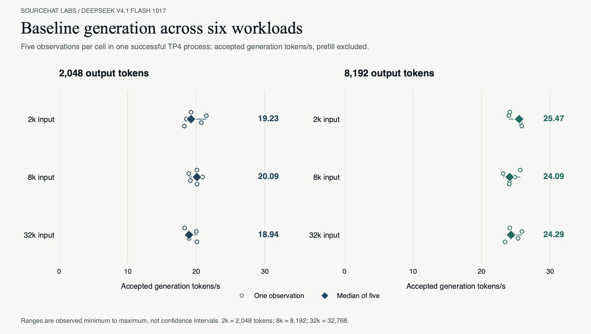
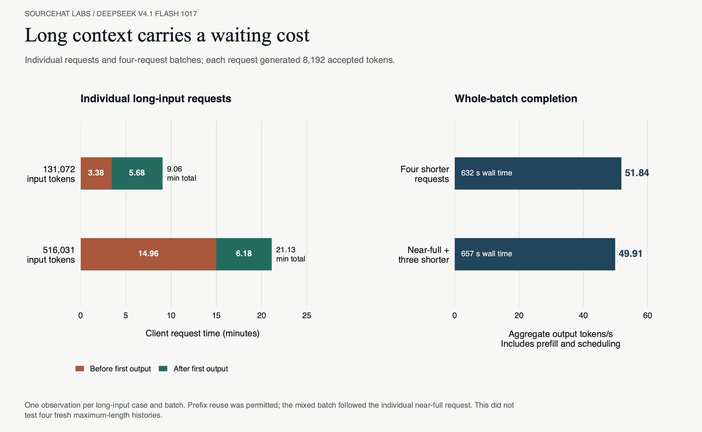
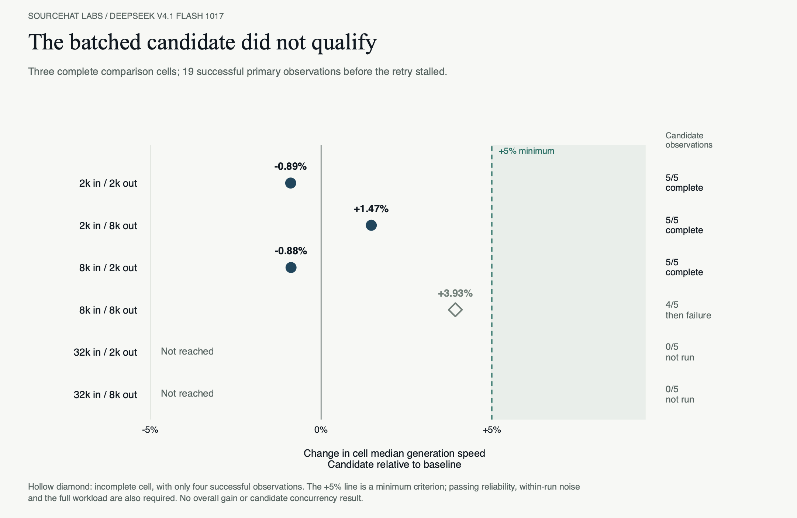

# DeepSeek V4.1 Flash 1017: Four-Card Serving

[Retained native reference profile](../profiles/deepseek-v41-flash-1017-dspark5-tp4/README.md) | [Measurement data](../data/deepseek-1017-20261026/README.md)

## Serial Engram Serving And A Rejected Optimization

The serial-Engram configuration completed the required serving checks for the serial Engram
baseline on four CMP 170HX cards. Across six input/output combinations, median
generation rates ranged from 18.94 to 25.47 accepted tokens/s. The same process
completed a near-full-context request and both four-request concurrency checks.
The proposed batched Engram optimization stalled in two attempts and did not
establish a qualifying speed improvement. We retained the serial baseline.

The deployed change was a startup compatibility repair. A fresh production launch
subsequently passed a short inference request and the four API/code checks. That
repair addresses model inspection at startup; the intermittent GPU stall remains
unexplained.

### Configuration And Measurement Scope

The configuration uses the DeepSeek V4.1 Flash 1017 EXL3 2.9 bpw artifact, four-card
tensor parallelism, a 524,288-token context limit, four active slots, FP8 KV,
maximum automatic KV sizing, and 8,192 MiB of total host KV offload across the
service. DSpark retained five draft tokens. The requested cap was 200 W per card;
that setting is not an average-power measurement. Immutable Engram backing
remained on NVMe; working files, caches and reports stayed on SATA.

These results form a separate configuration and workload from the earlier
three-card DeepSeek V4.1 Flash rows. GPU count, artifact revision, software epoch and output
budgets differ. The two datasets do not isolate the benefit of adding a card or
changing the runtime.

The focused protocol called for five observations of each combination of
2,048/8,192/32,768 target input tokens and 2,048/8,192 output tokens. One successful
baseline process completed all 30 primary observations, two individual long-input
requests, and eight requests across the two concurrency scenarios: 40 measured
requests in total. Warmup and the four API/code checks were additional. The
successful baseline process was reused, with no repeat-baseline run.

### The retained baseline

| Target input tokens | Output tokens | Median generation, tokens/s | Observations |
| ---: | ---: | ---: | ---: |
| 2,048 | 2,048 | 19.23 | 5 |
| 2,048 | 8,192 | 25.47 | 5 |
| 8,192 | 2,048 | 20.09 | 5 |
| 8,192 | 8,192 | 24.09 | 5 |
| 32,768 | 2,048 | 18.94 | 5 |
| 32,768 | 8,192 | 24.29 | 5 |

*Figure 1. Each small point is one observation; the large marker is the median
of five. The lines show observed minimum to maximum, rather than confidence
intervals. Generation rate excludes the first delivered token block and measures
accepted tokens over the remaining streaming interval; it excludes prefill.*

First-token latency needs separate interpretation. Prefix caching was enabled,
and repeated primary requests used the same input construction and seed, without
a cache flush between observations. Their median first-token waits of roughly
0.42-0.51 seconds therefore do not describe fresh-input prefill. The first primary
8,192-target-input request waited 13.20 seconds, and the first
32,768-target-input request waited 50.80 seconds. Actual cache-hit counts were
not retained.

The individual long-input cases give a clearer view of the waiting cost:

| Actual input tokens | Output tokens | First-token wait, seconds | Generation, tokens/s | Total request time, seconds |
| ---: | ---: | ---: | ---: | ---: |
| 131,072 | 8,192 | 202.74 | 24.04 | 543.40 |
| 516,031 | 8,192 | 897.37 | 22.11 | 1,267.89 |

The near-full request waited almost 15 minutes before its first output. Both
long-input cases ran once in the same process after the primary measurements;
they are single observations, with prefix reuse permitted.

Both concurrency scenarios also completed once:

| Scenario | Requests | Total accepted output tokens | Batch wall time, seconds | Aggregate completion, tokens/s |
| --- | ---: | ---: | ---: | ---: |
| Four requests, each targeting 8,192 input tokens | 4 | 32,768 | 632.11 | 51.84 |
| Near-full input plus 8,192/16,384/32,768-target-input companions | 4 | 32,768 | 656.54 | 49.91 |

These aggregate rates include input processing, scheduling and generation over
the whole batch. Each request produced 8,192 accepted output tokens. Individual
generation rates were 13.30-14.81 tokens/s in the shorter batch and
13.68-14.02 tokens/s in the mixed batch. First-token waits ranged from
2.74-51.35 seconds and 53.27-68.04 seconds respectively.

*Figure 2. The left panel separates time before first output from the rest of
the individual request. The right panel reports whole-batch completion rates,
including prefill. The mixed batch followed the individual near-full request
with prefix reuse permitted. It does not qualify four simultaneous fresh
maximum-length histories.*

### Why the batched candidate was rejected

The strongest earlier screening candidate batched Engram work with a 64 MiB row
cache budget per table and tensor-parallel rank. The adoption rule required at
least a 5% generation gain beyond observed within-run variation, passing
API/code checks, and completion of the required long-context and mixed workload.
First-token and concurrency costs were to be reported without a fixed latency
rejection cap.

The candidate passed warmup and all four API/code checks in both focused attempts.
Its first attempt stalled after 625 accepted tokens in the first primary request.
The diagnostic retry completed 19 primary observations, then stalled after 3,343
tokens in the next 8,192-input/8,192-output request. The suite stopped at that
failure, before either long-input case or either concurrency scenario.

| Target input / output tokens | Baseline median, tokens/s | Candidate median, tokens/s | Generation change | Candidate observations |
| --- | ---: | ---: | ---: | --- |
| 2,048 / 2,048 | **19.23** | 19.06 | -0.89% | 5 of 5 completed |
| 2,048 / 8,192 | 25.47 | **25.85** | +1.47% | 5 of 5 completed |
| 8,192 / 2,048 | **20.09** | 19.91 | -0.88% | 5 of 5 completed |
| 8,192 / 8,192 | 24.09 | 25.04 | +3.93% | 4 completed; next request failed |
| 32,768 / 2,048 | 18.94 | Unmeasured | Unmeasured | Not reached |
| 32,768 / 8,192 | 24.29 | Unmeasured | Unmeasured | Not reached |

*Figure 3. Complete cells retain five observations per configuration. The hollow
marker is an incomplete four-observation result. The +5% line is only the minimum
speed criterion; reliability, within-run variation and workload completion also
matter. Missing measurements are not zero throughput.*

The complete comparisons were close to baseline. One complete cell's median
first-token wait fell from 0.505 to 0.374 seconds, but that repeated-input result
does not establish a cold-prefill improvement. No full-suite generation gain or
candidate concurrency cost was measured. Earlier baseline attempts had also
stalled, so the retained successful run does not prove that an intermittent fault
was eliminated or that batching uniquely caused it. The checked candidate
windows recorded no NVIDIA Xid, job OOM event or thermal-guard failure; those
observations did not identify the stall's cause.

### Startup Compatibility And API Checks

The retained production profile now enters through the compatibility startup
path used for qualification. A cold-cache model-inspection subprocess had been
unable to import an observer logging handler, producing a generic validation
failure. The repaired import bootstrap preserves the original baseline
interpreter and native plugin selection.

A fresh launch passed a 256-token inference request, code,
JSON-schema, tool-call and numeric-reasoning-effort checks. This was a deployment
check, with no new primary or capacity observations. The batched candidate
remains disabled. Within-run samples are available, while between-run baseline
drift, exhaustive model quality and the underlying GPU stall cause remain
unmeasured or unresolved.

*[Numeric observations and definitions](../data/deepseek-1017-20261026/README.md) accompany these experiments.
All tables and figures use the saved measurements; no inference was rerun to
prepare this update.*
